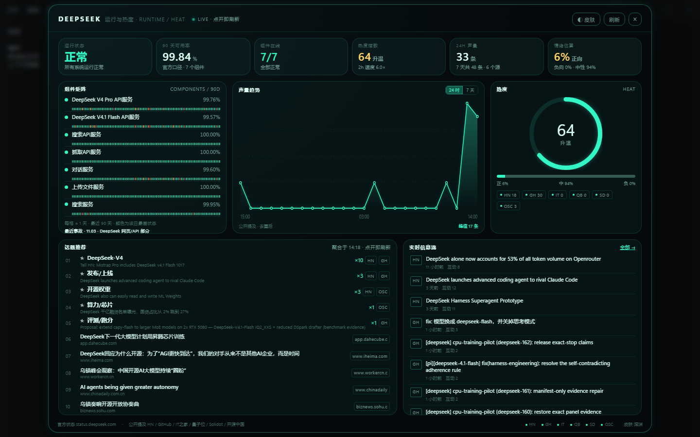
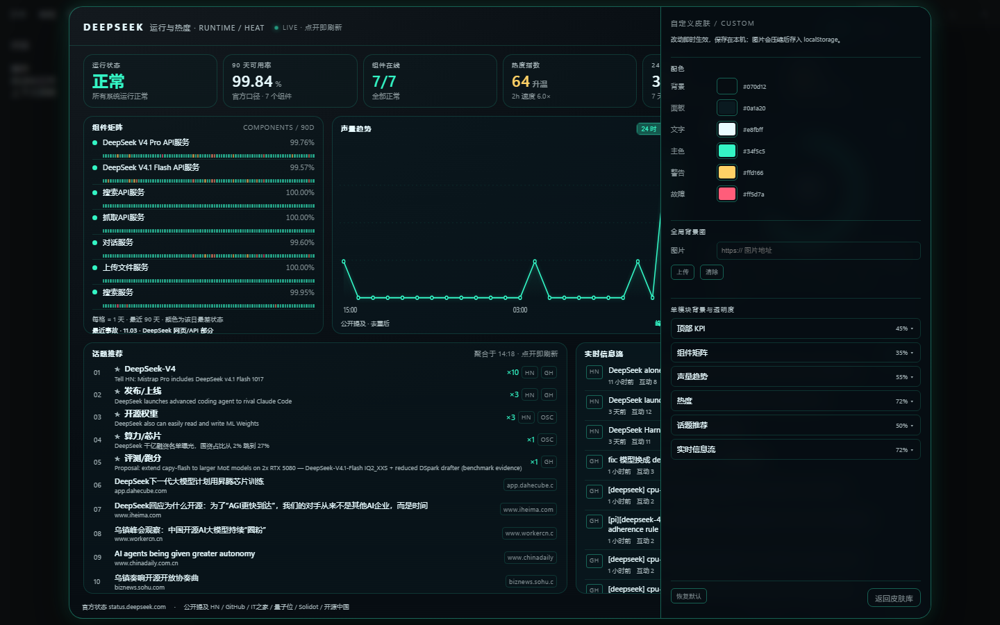

# dsh-status-dashboard

> 插件市场：[DeepSeek Harness Hub](https://deepseek.stream/plugins/dsh-status-dashboard) · [GitHub Releases](https://github.com/LiangeXeu/dsh-status-dashboard/releases)

DeepSeek 运行与热度仪表盘：标题栏右侧一枚按钮，点开是三套内置皮肤 + 自定义皮肤的高密度 HUD，数据点开即刷新。



## 0.3.0（信息流源切换）

- **实时信息流支持切换源**：`全部 / HN / GitHub`，GitHub 标签页直接显示 DSH 插件更新，不再只跳 HN；
- GitHub 插件流独立于热度统计，只读 `topic:dsh-plugin`，只收录**最近 24 小时**内推送的仓库，按 `pushed_at` 倒序，最多 **30 条**；10 分钟缓存，403/限流回退上次缓存；
- HN 标签页单独按时间排序，收录**最近 30 天**的 HN 故事，最多 **30 条**，不是混合流里的前 14 条；30 天只用于信息流，热度/话题仍按最近 7 天统计；
- 切换标签会记住；GitHub 首次点击才请求，不拖慢 HUD 打开；
- 版本号 `0.3.0`，页脚显示版本。

## 0.2.5（内部预览，未发布）

- **补位排除 GitHub 修复**：宿主 feed 增加 `sourceId`，客户端按 id 过滤，GitHub issue 不再被当成新闻补进第 7–10 行；
- **AI 限流不再清空列表**：429 时保留上次结果并标注"搜索限流"，3 秒后自动重试；打开 HUD 3 秒内复用，避免自己触发限流；
- **本地偏好真正生效**：点击 + 停留数据只在本地提取关键词，对同一时效桶内的 AI/补位行做小幅重排；不向 Search API 发送任何个人标签；
- **自定义皮肤多方案**：可命名、新建、复制、删除、导入/导出 JSON；每个方案独立保存；"恢复默认"需确认；
- **自定义配色补"正常"色**：正常/警告/故障与主色分离；图片压缩上限降到约 1.8MB，并增加 4MB 总配额保护；
- **界面修整**：底部 23 个源改为"源 N/M"汇总；AI 行去掉重复域名、改为显示摘要/来源；隐私入口上移到顶栏；悬停卡按异常优先展示；初始加载不再显示警告黄；弹窗改为实体底；自定义皮肤关闭扫描线；小屏不再隐藏"今日新话题不足"提示。

## 0.2.4

- **7 天时效硬闸门**：AI 搜索结果只保留发布时间 7 天内的内容；7–30 天仅热度分 ≥6 的条目，最多 2 条；超 30 天、无发布日期的直接丢弃；
- **补位到 10 条**：不足时从 23 个公开源的单条新闻里按“时效桶 → 来源权重 → 发布时间”补位，仍不足才少显示，不用旧文凑数；
- **新增全球/中国媒体源**：ABC、CBS、NPR、Sky、France 24、NHK、朝日、韩联社、CGTN、新华网、人民网、Techmeme、Ars Technica、Wired、Lobsters、Slashdot、爱范儿；
- **阅读偏好弹窗**：首次打开 HUD 询问是否开启；默认关闭；只在本机记录“话题标签 + 估算停留时长”，不记录 URL/页面内容，不上传、不出售；可随时关闭与清除；
- **停留阈值**：<20 秒无效；20 秒–20 分钟有效；20–40 分钟弱有效；>40 分钟无效；
- 偏好不参与外部查询：搜索只用公共角度词与静态种子，个人点击/停留数据不出本机。

## 0.2.3

- 许可证从 MIT 切换为 **DSH 仪表盘署名许可 1.0（DSAL-1.0）**：源码公开、保留署名、衍生作品同许可；**不是 OSI 开源许可**；
- 功能与 0.2.2 一致。

## 0.2.2 正式版

- **运行与热度 HUD**：官方状态页（7 个组件、90 天可用率、逐日色块、事故时间线）+ 公开提及聚合（HN、GitHub、IT之家/量子位/Solidot/开源中国）的声量、情绪、热度与信息流；
- **固定 10 条话题**：聚合话题占前 1–6 条并用 ★ 标记，其余由 DSH 账号搜索补足到 10 条；每次打开/刷新重新查询、重新排序，点击偏好按次数加权；
- **四套皮肤**：深渊 / 终端 / 纸面 + 自定义；自定义支持全局与 6 个模块的背景图、模块透明度，以及背景/面板/文字/主色/警告/故障六组颜色；
- **视觉系统**：8px 栅格、5 级字号、颜色全部走 token（含状态色与 partial），趋势图响应式适配容器，HoverCard 跟随当前皮肤，移除面板 accent 条与 KPI 渐变，减弱光晕/扫描线，话题列表去虚线；
- **可靠性**：全源失败回退上次完整快照并标 `stale`，部分失败不覆盖完整快照；`force+hard` 真正全量刷新；输入框快捷键守卫；搜索结果 URL 白名单；搜索 35s 总预算与空结果回退；`/health` 暴露源快照，`/ai-topics` 3s 限流；
- **工程**：8 个 `node:test` 离线用例（解析、聚合回退、路由、搜索降级、情绪词），`npm test` / `npm run check`，MARKET.md 上架清单，版本 `0.2.2`。




## 功能

- **运行**：官方状态页总体状态、7 个组件、90 天可用率、逐日色块（每格 1 天，颜色为当日最差状态）、事故时间线；
- **热度**：公开提及聚合——24h 声量、2h 速度、热度指数、情绪估算、来源分布；
- **话题推荐**：点开面板即强制刷新，按关键词聚类出 Top 话题，点击跳转原帖；
- **实时信息流**：按「互动 × 新鲜度」排序，带来源徽标与时间；
- **皮肤**：深渊 / 终端 / 纸面 / 自定义，右上角「◐ 皮肤」切换，按 1/2/3 切换前三套，选择持久化；
- **响应式**：1280×719 自动压缩间距；遵循 `prefers-reduced-motion`。

## 数据来源与口径

| 层 | 来源 | 刷新 |
| --- | --- | --- |
| 官方状态 | https://status.deepseek.com （解析首屏 RSC 数据） | 60s 缓存 |
| 公开提及 | HN / GitHub / ABC / CBS / NPR / Sky / France 24 / NHK / 朝日 / 韩联社 / CGTN / 新华网 / 人民网 / Techmeme / Ars / Wired / Lobsters / Slashdot / IT之家 / 量子位 / Solidot / 开源中国 / 爱范儿 | 聚合 60s，单源 15 分钟；点开/刷新用 `hard=1` 全量刷新；宿主每 10 分钟预热 |
| AI 话题 | DSH 账号 token + DeepSeek 官方 Search API（无需 API key；拿不到 token 时回退 `ctx.web`） | 每次打开/刷新一次；只保留 7 天内，补位到 10 条 |

边界：

- **情绪是词表估算**，不是模型判断，只作趋势参考；
- 中文社媒（微博/知乎/小红书）没有稳定公开接口，不接；
- 热度曲线依赖缓存积累，冷启动第一次打开可能需要几秒；
- 全源失败时展示上次快照并标「缓存快照」，不会把热度归零；部分源失败时保留完整快照；
- 状态页改版会打断 RSC 解析，届时退回上次快照并标 `stale`；
- 自定义皮肤图片存在浏览器 `localStorage`，换设备/清缓存会丢失；不上传任何服务器；
- **AI 搜索每次打开会发起一次真实检索**：用 DSH 已登录的 DeepSeek 账号 token 调官方 Search API，不消耗模型轮次；只有账号 token 不可用而回退到 `ctx.web` 时，才可能走 Messages 搜索并消耗一个模型轮次；
- 点击/停留偏好只在本地参与排序，不参与外部查询，不发送给任何第三方。

## 路由

宿主在 `/dsh-status-2417` 下提供：

- `GET /summary`：官方状态摘要；
- `GET /heat`：热度聚合（声量、情绪、话题、信息流、源健康）；
- `GET /ai-topics?seed=&interests=`：DeepSeek 搜索 AI 话题（每次调用重查）；
- `GET /health`：存活检查；
- `?force=1` 跳过聚合缓存；`?hard=1` 连单源缓存一起跳过。

为什么需要宿主：状态页与多数新闻源不带 `Access-Control-Allow-Origin`，浏览器直接 fetch 会被 CORS 拦掉；宿主在 Node 里取，页面只请求同源路由。

## 皮肤契约

三套内置皮肤共用同一棵组件树，只换 `--h-*` CSS 变量；自定义皮肤在此之上用运行时变量与逐模块内联背景：

```js
// 内置
{ id, name, en, tagline, preview: { bg, panel, line, accent, text } }
// 自定义（localStorage: dsh.status.custom.v1）
{ bg, panel, text, accent, image, modules: { status: { image, opacity }, ... } }
```

模块 id：`kpi` / `status` / `trend` / `heat` / `topics` / `feed`。

## 隐私与偏好

- 首次打开 HUD 会弹窗询问是否开启「阅读偏好记录」，**默认关闭**；不开启不影响任何功能；
- 只在本机 `localStorage` 记录：话题标签、估算停留时长（`dsh.status.reads.v1`）、点击计数（`dsh.status.interests`）；
- **不记录 URL、页面内容、账号信息；不上传、不出售、不公开**；插件没有服务器；
- 停留时间由窗口焦点/可见性估算，切窗口、挂机、手改本地存储都会影响结果，仅作软信号；
- 阈值：<20 秒无效；20 秒–20 分钟有效；20–40 分钟弱有效；>40 分钟无效；
- 可随时在 HUD 底部「隐私」里关闭记录，或一键清除本地数据；
- 搜索请求只用公共角度词与静态种子，**不把个人点击标签/停留时间发给 Search API**。

## 许可与署名

本项目**源码公开，但不是 OSI 开源许可**，采用 [DSH 仪表盘署名许可 1.0](LICENSE)：

- 允许使用、修改、分发与商用；
- 必须保留版权、许可与 [NOTICE](NOTICE)；
- 对外分发、公开部署或衍生作品必须显著署名并链接原仓库；
- 衍生作品对外分发时必须采用同一许可；
- 违反条件时授权自动终止，作者保留追究的权利。

推荐署名（可直接复制）：

> 基于 LiangeXeu 的《DeepSeek 运行与热度仪表盘》—— https://github.com/LiangeXeu/dsh-status-dashboard

思想、方法与数据口径不受版权保护；学术或文章引用欢迎注明来源。

## 安装

- 本地：`install.ps1` 复制到 `C:\DSH-NEXT-Lab\plugins\dsh-status-dashboard\<version>`、建 junction、写入 profile；
- 市场：安装后重启 DSH（宿主插件只在启动时挂载）。

## 测试

```sh
npm test   # node --test：解析 / 聚合回退 / 路由 / 搜索降级 / 情绪词
npm run check
```

## 开发

```sh
# 本地外观检查（不启动 DSH）
python -m http.server 5811 --bind 127.0.0.1
# 浏览器打开 http://127.0.0.1:5811/dev/harness.html?mode=hud&skin=abyss
# 自定义：?mode=custom-editor&skin=custom
```

`dev/` 只用于开发与截图，不随包发布（`files` 白名单已排除）。
